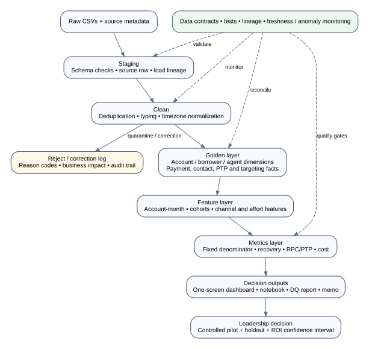

# Production Analytics Design

## Data flow

`Raw → Staging → Clean → Golden → Feature → Metrics → Dashboard`

### Raw and staging
- Land immutable source extracts with `source_system`, `extract_id`, `loaded_at`, file checksum, and `_src_row`.
- Define contracts for required columns, types, nullability, uniqueness expectations, timezone semantics, and schema version.
- Fail or quarantine schema-breaking inputs; do not silently infer incompatible schemas.

### Clean and reject
- Parse types explicitly and normalize event timestamps to Asia/Kolkata for business reporting while retaining the original timestamp and source timezone.
- Deduplicate by stable event ID (`payment_id`, `call_id`, `whatsapp_event_id`, etc.) with deterministic ordering.
- Keep rejected/corrected records in quarantine with `rule_id`, `reason`, source lineage, and run ID.
- Do not treat a repeated payment reference alone as a duplicate: compare payment ID, account, amount, status, provider, and event time.
- Preserve raw and normalized columns so corrections remain auditable.

### Golden entities and facts
- `dim_account`: one row per `account_id`; preserve account snapshot/effective dates if historical status or DPD changes.
- `dim_borrower`: canonical `borrower_id`, selected from valid versions; preserve SCD history.
- `dim_agent`: canonical internal agent ID plus a separate reviewed mapping for employee codes/vendor IDs.
- `dim_campaign`: campaign metadata with validity window and explicit strategy/definition version.
- `fact_payment`: one row per canonical payment event; `payment_id` primary key; settlement/reversal linkage; success status and normalized timestamp.
- `fact_contact`: one row per outreach event with channel, source event ID, reached/engaged definitions, agent/vendor/campaign where known.
- `fact_ptp`: one row per promise with maturity and observed cash-in-window; do not classify unresolved immature promises as broken.
- `fact_target`: one row per target event; never assume target status means contact happened.

### Metric definitions
- **Recovered amount:** sum of deduplicated, settled successful payment amount net of reversals/chargebacks; if settlement linkage is unavailable, label `SUCCESS` as a provisional proxy.
- **Recovery rate:** recovered amount in the period divided by a clearly stated fixed book/outstanding denominator, with numerator/denominator dates aligned.
- **Recovery per account:** recovered amount divided by all eligible accounts in a fixed book, not only payers or contacted accounts.
- **Contact rate:** unique eligible outbound calls meeting a predeclared connection rule divided by eligible outbound attempts. Report attempt-level and account-level rates separately.
- **RPC:** unique reached right-party contacts divided by eligible contact attempts; require a reliable disposition-to-person mapping.
- **PTP kept rate:** matured PTPs with verified payment within the agreed grace window divided by matured PTPs eligible for evaluation. Show agent-coded status separately from cash-validated status.
- **Channel conversion:** unique eligible accounts reached by a channel with a qualifying payment within a fixed window, divided by all eligible accounts reached; this is descriptive unless randomized.
- **Cost per recovered rupee:** fully loaded channel/agent/vendor costs divided by verified incremental recovery; do not compare channels if costs are incomplete.

### Incremental processing, late data, and backfills
- Use `event_time` for business periods and `ingestion_time` for pipeline operations.
- Maintain a configurable lateness watermark; reprocess recent partitions when late-arriving events land.
- Make every transformation idempotent using stable keys and deterministic tie-breaking.
- Backfills should be replayable by date partition and transformation version; retain old metric snapshots for reconciliation.
- Version metric definitions and dashboards. Publish a change log when definitions or source mappings change.

### Data-quality controls
- Uniqueness checks on primary keys and expected composite keys.
- Referential integrity checks for account, borrower, agent, campaign, vendor, and provider keys.
- Validity checks for event timestamps, timezone names, amounts, statuses, and lifecycle ordering.
- Reconciliation of raw row counts, rejected rows, corrected rows, and golden row counts.
- Payment reconciliation: success, pending, failed, reversed, and settled amounts; alert on unexplained movements.
- Completeness/freshness checks by source and expected delivery cadence.
- Drift checks on channel mix, DPD mix, campaign mix, disposition codes, vendor codes, and denominator size.

### Monitoring and anomaly detection
- Alert on pipeline failure, missing/late files, schema drift, duplicate-rate spikes, null-rate spikes, unexpected row-count changes, and reconciliation variance.
- Monitor daily recovery per observed day, payers, recovery per account, contact/RPC/PTP metrics, complaints, and cost per recovered rupee.
- Use robust rolling baselines and seasonal comparisons; annotate partial months, holidays, strategy changes, and backfills.
- Dashboard each metric with definition/version, freshness timestamp, numerator, denominator, and confidence/quality status.

## Counterfactual and investment evaluation

Use a randomized holdout or phased rollout stratified by DPD, loan type, client, geography, and channel. Pre-register an intention-to-treat outcome: settled recovery net of reversals and incremental costs per eligible account over a fixed horizon. Report confidence intervals, downside case, break-even volume, and borrower-impact guardrails. Observational attribution and propensity matching may support sensitivity analysis but cannot fully remove unmeasured confounding.
